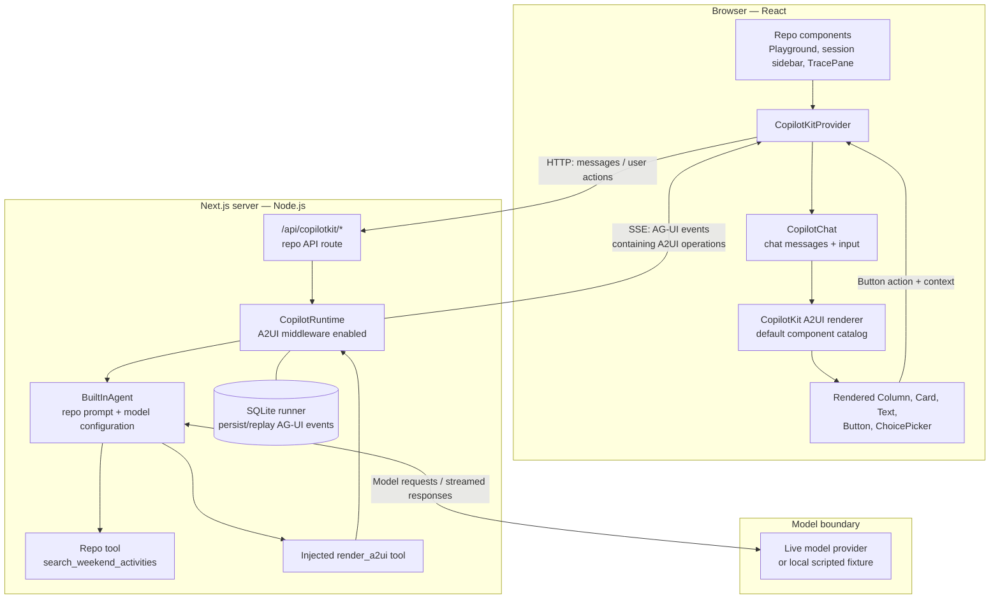

# CopilotKit, AG-UI, and A2UI architecture

This repo defines the app shell, agent behavior, tools, and example UI payload. CopilotKit packages supply the chat UI and the default A2UI component implementations.



## Boundaries and responsibilities

- **Browser:** renders the app shell, chat, and A2UI surfaces, and forwards user interactions to the server.
- **Next.js server:** runs the agent, executes business tools, converts UI tool output into A2UI operations, and persists AG-UI events through the SQLite runner.
- **Model provider:** generates text and tool calls. In fixture mode, a local scripted model replaces the external provider.
- **AG-UI:** carries agent events between the server and browser.
- **A2UI:** describes the generated UI's component composition, data bindings, and actions.

## Where components are defined

| What | Where defined | Who supplies it |
|---|---|---|
| App shell, sidebar, trace pane | [`Playground.tsx`](../src/components/Playground.tsx), [`TracePane.tsx`](../src/components/TracePane.tsx), [`globals.css`](../src/app/globals.css) | This repo |
| Chat UI and provider | `@copilotkit/react-core/v2` | CopilotKit |
| A2UI `Column`, `Card`, `Button`, and other component implementations | `@copilotkit/a2ui-renderer`, pulled in by React Core | CopilotKit's default A2UI catalog |
| Composition of those A2UI components | Live model output, or `surfaceArgs()` in [`fixture-model.ts`](../src/lib/server/fixture-model.ts) | Agent / scripted fixture |

For example, `{ component: "Card", ... }` describes a card; it does not implement one. The frontend catalog maps `"Card"` to the actual rendering implementation.

The backend enables the A2UI tool and middleware in [`runtime.ts`](../src/lib/server/runtime.ts):

```ts
a2ui: { injectA2UITool: true }
```

The agent prompt in [`agent.ts`](../src/lib/server/agent.ts) tells the model to search for activities and call `render_a2ui` to present interactive results.

The frontend uses `CopilotKitProvider` and `CopilotChat` in [`Playground.tsx`](../src/components/Playground.tsx). This repo supplies no custom A2UI catalog, so CopilotKit uses its defaults. The backend does not define React components.

## Example A2UI layout

The scripted fixture's `surfaceArgs()` defines this composition:

```text
Column
├── Title
├── Note
├── Column: repeats a Card for each /items entry
│   └── Card
│       └── Column
│           ├── Name
│           ├── Description
│           ├── Cost/duration
│           └── “Pick this” button
├── Divider
├── Preferences heading
├── Setting picker
└── “Update suggestions” button
```

Clicking a button forwards an A2UI action and its context in a new agent run. The agent can acknowledge a selection or search again and render updated results.

## Mapping to Svelte and FastAPI

In a Svelte/FastAPI implementation, a Svelte A2UI renderer and component catalog would occupy the renderer/catalog box. FastAPI and the agent would occupy the server boxes. AG-UI would continue carrying the events between them.
